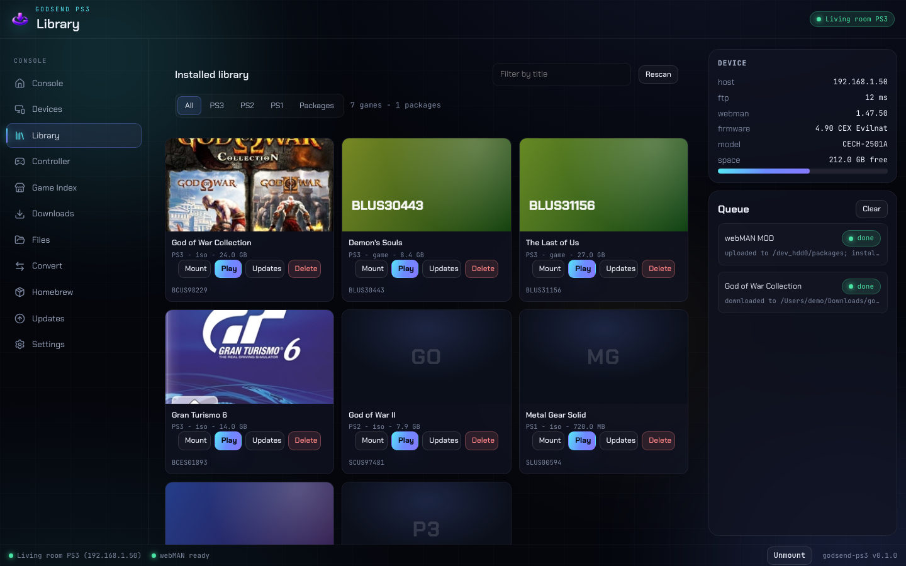

# GODsend PS3

[](https://ghostyshell.github.io/godsend-ps3/)
[](https://discord.gg/d3sFnrgpJn)
[](https://ko-fi.com/ghosty99)
[](https://etherscan.io/address/0xbBef115aD853236a350EaF04777a2AdB2e7c0317)

A desktop workshop for a CFW or HEN PlayStation 3. It connects over FTP,
reads the installed library, drives the console with a virtual controller,
downloads games and homebrew to your Mac or PC, converts images between the
formats PS3 tools use, and installs everything back onto the console.

GODsend PS3 shares the GODsend family's "midnight console" design and the
Rust + Tauri stack of [GODsend PSP](https://github.com/ghostyshell/godsend-psp).



## Download

<!-- downloads:start -->
| Build | GoFile (primary) | file.kiwi (backup) | Size |
| --- | --- | --- | --- |
| pending | pending | pending | |
<!-- downloads:end -->

GoFile is the primary host and file.kiwi is the encrypted backup, the same
mirror pair as GODsend PSP and GODsend 360. Desktop builds are not notarized:
on first launch, right click the app, choose Open, then Open again, or run
`xattr -dr com.apple.quarantine "/Applications/GODsend PS3.app"`.

Every build on a `v*` tag is produced by CI for macOS (Apple Silicon and
Intel), Linux and Windows. The CLI archive also contains the MCP server
binary.

## What it does

**Console management**
- Add several PS3s, probe FTP and webMAN MOD, pick the active one.
- LAN discovery: scans port 21 and keeps hosts that answer as a PS3.
- Shows firmware, CFW name, model, webMAN version and internal HDD space.
- System actions: unmount, refresh XMB, rebuild database, screenshot,
  notification popup, quick restart, power off.

**Library**
- Scans `/dev_hdd0/game`, `/dev_hdd0/GAMES`, `PS3ISO`, `PS2ISO`, `PSXISO`,
  `PSPISO`, `ROMS`, `pkg` and `packages`, plus USB devices.
- Reads PARAM.SFO over FTP for titles, title ids, versions and ICON0 art.
- Mounts a game, or mounts and launches it, through webMAN.
- Shows and installs official update packages from ps3-resources.
- Deletes a game folder, ISO or package when you confirm it.

**Virtual controller**
- On-screen DualShock layout over webMAN's `/pad.ps3` commands.
- Press and hold works while the pointer is down, so XMB navigation feels real.
- Keyboard mapping for the d-pad, face buttons, triggers, sticks, select,
  start and PS.
- Combos (L3+R3, SELECT+START and custom chords) and text macros.
- Analog stick directions for both sticks.

**Downloads and installs**
- Game index search (the GameSearch debrid service) and Internet Archive
  search, with the files listed before you pick one.
- PS3 homebrew catalog from GitHub releases: webMAN MOD, prepISO, PS2
  Classics Launcher, PS2CONFIG, IRISMAN, Apollo Save Tool, ManaGunZ.
- Downloads use aria2c with 16 connections when installed, plain HTTP
  otherwise. Jobs show progress and can be cancelled.
- Sending to the console classifies the file: PKG to `/dev_hdd0/packages`,
  PS3/PS2/PS1/PSP ISOs to their folders, game folders to `/dev_hdd0/GAMES`,
  ZIPs are unpacked first. A PKG is installed through webMAN right after the
  upload when that option is on.

**Conversions**
- Game folder to ISO: ISO9660 plus Joliet, multi-extent files over 4 GiB.
- ISO to folder: reads both the ISO9660 and Joliet trees, PS3 layouts.
- Split for FAT32: `name.0`, `name.1` at a configurable chunk size.
- Merge a split set back into one file.
- Decrypt Redump ISOs with a dkey: AES-128-CBC region decryption, key from a
  pasted value or looked up by filename in ps3-resources.

**Files**
- Two-pane local and console browser: upload, download, create folders,
  delete, with progress in the job queue.

**MCP server**
- Starts with the app on loopback, default `http://127.0.0.1:8743/mcp`.
- Tools cover status, library, mount, install, pad presses, system actions,
  files, conversions, search, homebrew and updates, so an agent drives the
  same paths the UI does.
- A standalone `godsend-ps3-mcp` binary speaks stdio for clients that spawn
  their own server.

## Requirements

- macOS 12+, Windows 10+ or a Linux desktop with WebKitGTK.
- A PS3 on CFW or HEN with an FTP server running. webMAN MOD includes one.
- webMAN MOD on port 80 for mounting, the virtual pad and system actions.
  Everything FTP-only still works without it.
- Optional: `aria2c` on PATH for multi-connection downloads.
- Optional: an MCP client, for the loopback server that starts with the app.
- Optional: Real-Debrid and/or TorBox keys for debrid links.
- Optional: a reachable GameSearch backend for download link resolution.
  The public site hides links behind sign-in, so browsing works but resolving
  needs the Go service. Internet Archive downloads need neither.

## Build

```sh
cargo test --workspace
npm --prefix app install
npm --prefix app run build
npm --prefix app run tauri build
```

The CLI is `cargo build --release -p godsend-ps3-cli`; the binary is
`godsend-ps3`. Run it with no arguments for the command list. The MCP stdio
binary is `cargo build --release -p godsend-ps3-mcp`.

Connect an MCP client while the app is open:

```sh
claude mcp add --transport http godsend-ps3 http://127.0.0.1:8743/mcp
```

The server binds loopback only and has no authentication, by design. Set the
port to 0 in Settings to disable it.

## Configuration

Settings are stored as JSON in the platform data directory
(`~/Library/Application Support/godsend-ps3` on macOS,
`%APPDATA%\godsendps3\godsend-ps3` on Windows). The same folder holds the job
journal and cached ICON0 art.

FTP on a PS3 server is plaintext and usually accepts `anonymous` with no
password. Keep the console on your own network.

## What it deliberately does not do

- PKG decryption and NPDRM: that needs console keys the app does not ship.
- PS2 Classics packaging and PS1 EBOOT creation: those need Sony's tools and
  per-game encryption; use the console-side tools for them.
- Copying a game from the internal HDD to another PS3 automatically: use the
  File Manager's download then upload, so you see every byte move.

## Tests

- `cargo test --workspace`: parsers, ISO9660 writer round trip, decrypt round
  trip, split and merge, webMAN command encoding, and an end-to-end test
  against a fake FTP server and a fake webMAN HTTP server.
- `npm --prefix app run test:ui`: Playwright against the mock bridge
  (`/?mock=1`), covering every page.

## Links

- Website and screenshots: https://ghostyshell.github.io/godsend-ps3/
- Guides: [docs/guides](docs/guides/index.md)
- Changelog: [CHANGELOG.md](CHANGELOG.md)
- Discord: https://discord.gg/d3sFnrgpJn
- Ko-fi: https://ko-fi.com/ghosty99
- ETH: `0xbBef115aD853236a350EaF04777a2AdB2e7c0317`

## Layout

```
core/   Rust engine: FTP, webMAN, library, ISO/PKG/decrypt, jobs
cli/    headless CLI
app/    Tauri 2 shell
  src/  React + TypeScript UI, styles.css, mock.ts
```

MIT licensed.
